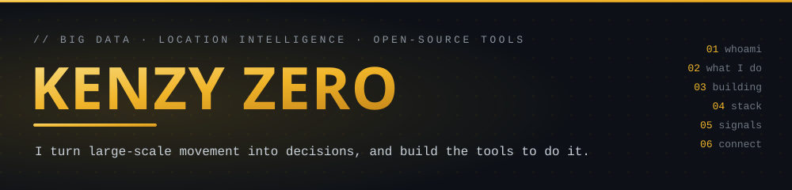
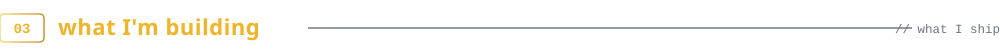
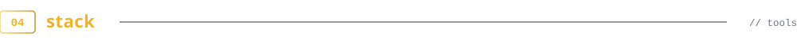
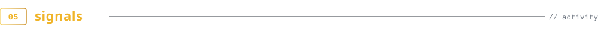
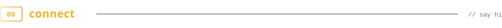

<!-- ============ custom hero ============ -->


<!-- ============ quick links ============ -->
<p align="center">
  <a href="https://pypi.org/project/kenze/"></a>
  <a href="https://github.com/Kenzy-Zero?tab=repositories"></a>
  <a href="mailto:kenzy.zero.k0@gmail.com"></a>
  
</p>

<br/>

<!-- ============ 01 whoami ============ -->


<br/><br/>

<!-- ============ 02 what I do ============ -->


> I work with **large-scale location and movement data**: billions of raw device pings, cleaned and turned
> into footfall, catchments, home and work areas, audiences and maps that real decisions get made on.
> Years of building the whole path end to end, from the raw files to the shipped product.

- Building a **location-intelligence platform**: turning *where people go* into planning and insight
- Pipelines at two scales: **DuckDB on a laptop, PySpark on a cluster**, the same cleaning rules on both sides
- Maps people can use: indoor store polygons, drive-time areas, story maps, dashboards that filter the map
- The unglamorous part done properly: de-duplication, sink detection, time zones, determinism, run logs
- Drawn to problems where **data meets the real world**

<br/>

<!-- ============ 03 what I'm building ============ -->


#### kenze &nbsp;·&nbsp; <sub>shipped and live on PyPI</sub>

> **Big-file data prep that never runs out of memory.** An interactive shell *and* a one-line CLI for
> CSV / Parquet / JSON / Excel files that are too big for pandas. DuckDB does the heavy lifting; kenze
> auto-sizes memory so the job never crashes, and there is no SQL to learn and no lock-in.
>
> 40 commands for the everyday work. Autocomplete that knows the **real values in your file**, with
> exact row counts. Live previews on every step. Model-ready in one step (`scale`, `bin`, `encode`,
> `traintest`). Client-ready PDF / HTML reports. Excel and GeoJSON in and out. Reads `s3://` directly.
> Every recipe ejects to plain DuckDB SQL or Python.

```bash
pip install kenze          # then just run:  kenze
```

<a href="https://github.com/Kenzy-Zero/kenze"></a>

<p>
  <a href="https://github.com/Kenzy-Zero/kenze"></a>
  <a href="https://pypi.org/project/kenze/"></a>
  <a href="https://pepy.tech/project/kenze"></a>
  <a href="https://github.com/Kenzy-Zero/kenze/actions"></a>
  <a href="https://github.com/Kenzy-Zero/kenze/stargazers"></a>
  <a href="https://github.com/Kenzy-Zero/kenze/blob/main/LICENSE"></a>
</p>

#### Kenzehub &nbsp;·&nbsp; <sub>in development, private until it is polished</sub>

> **Big messy files in, a client-ready document out.** A local-first desktop app (Tauri + DuckDB) that
> opens files far bigger than Excel can, lets you shape and check them in a grid, and writes a finished
> PDF / Word / HTML report. Nothing leaves the machine: no account, no upload, no server. The export is
> fully offline too, with zero scripts and zero external references. Thousands of tests and counting.

<p>
  
  
  
</p>

#### kenzeplan &nbsp;·&nbsp; <sub>early build</sub>

> **A vector PDF floor plan in, IMDF and GeoJSON out, fully offline.** Reads the shapes and the unit
> labels from the plan, joins them to a tenant list, georeferences the floor and writes the OGC IMDF
> standard, validated locally against the spec. On known ground truth it recovers 9 units in 10, with
> 99.7% of them attached to the right shape. Written clean-room from scratch.

<p>
  
  
</p>

#### On the bench

| Project | What it is | Where it stands |
|---|---|---|
| **K-Series** | The mobility data layer: a GeoParquet profile plus the movement verbs (cleaning, home, work, dwell, trips, catchments), built on kenze's engine. | groundwork, starts after Kenzehub |
| **Z-Series** | `.z1`, an open documentation standard for the AI era: machine-first project docs at around 10x fewer tokens than a README. Working CLI. | paused |
| **A toy-city open world** | A real city rebuilt in the browser as a walkable, drivable toy city, from open map data only. Codename for now. | playable, friends beta next |

<br/>

<!-- ============ 04 stack ============ -->


<p>
  
  
  
  
  
  
  
  
  
  
  
  
  
  
  
</p>

<br/>

<!-- ============ 05 signals ============ -->


<p align="center">
  <a href="https://github.com/Kenzy-Zero"></a>
  <a href="https://github.com/Kenzy-Zero/kenze/commits/main"></a>
  <a href="https://github.com/Kenzy-Zero/kenze/releases"></a>
  
</p>

<p align="center"><sub>Most of the work lives in private repos until it is polished enough to show. The public ones are the finished goods.</sub></p>

<br/>

<!-- ============ 06 connect ============ -->


<p>
  <a href="https://github.com/Kenzy-Zero"></a>
  <a href="https://www.linkedin.com/in/kenzy-zero/"></a>
  <a href="https://x.com/kenzy_zero"></a>
  <a href="https://www.reddit.com/user/kenzy_zero/"></a>
  <a href="mailto:kenzy.zero.k0@gmail.com"></a>
  <a href="https://pypi.org/project/kenze/"></a>
</p>

<br/><br/>


