<!-- Kenzy Zero · profile README. The cards are SVGs rendered by tools/build.py (static) and
     tools/signals.py (daily, by the signals workflow). Design tokens live in tools/kz.py. -->


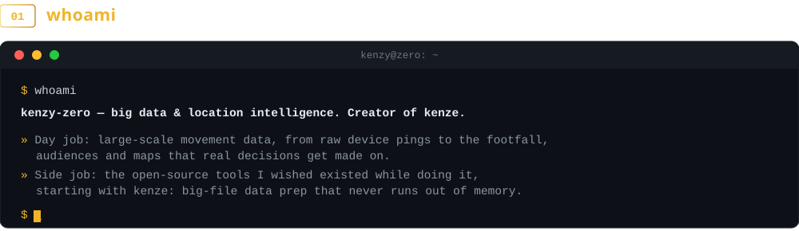

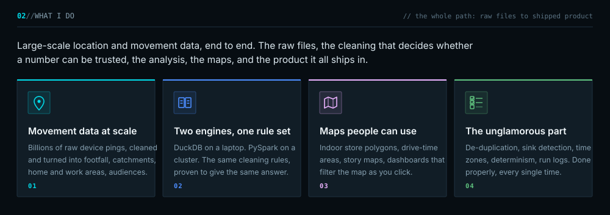

<a href="https://github.com/Kenzy-Zero/kenze">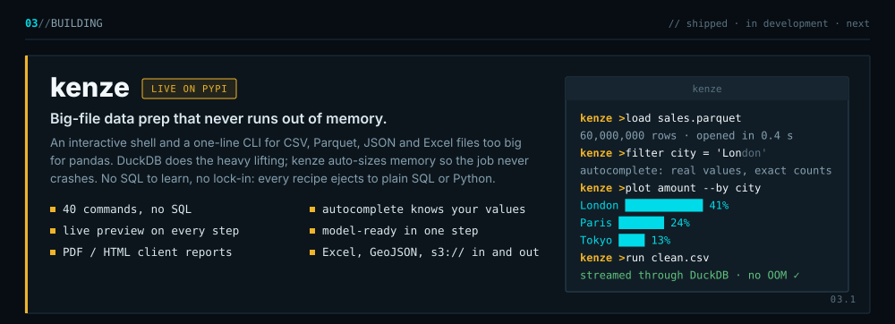</a>

```bash
pip install kenze          # then just run:  kenze
```

<a href="https://github.com/Kenzy-Zero/kenze"></a>

<p>
  <a href="https://github.com/Kenzy-Zero/kenze"></a>
  <a href="https://pypi.org/project/kenze/"></a>
  <a href="https://pypi.org/project/kenze/"></a>
  <a href="https://github.com/Kenzy-Zero/kenze/actions"></a>
  <a href="https://github.com/Kenzy-Zero/kenze/releases"></a>
  <a href="https://github.com/Kenzy-Zero/kenze/stargazers"></a>
  <a href="https://github.com/Kenzy-Zero/kenze/blob/main/LICENSE"></a>
</p>

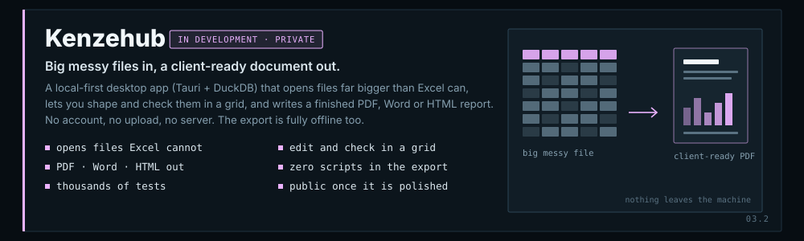

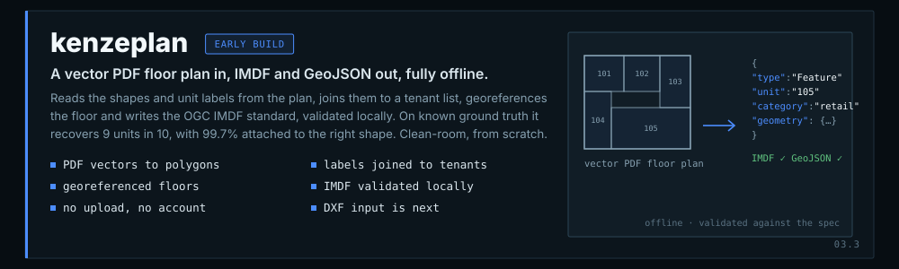

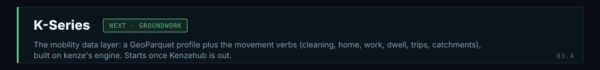

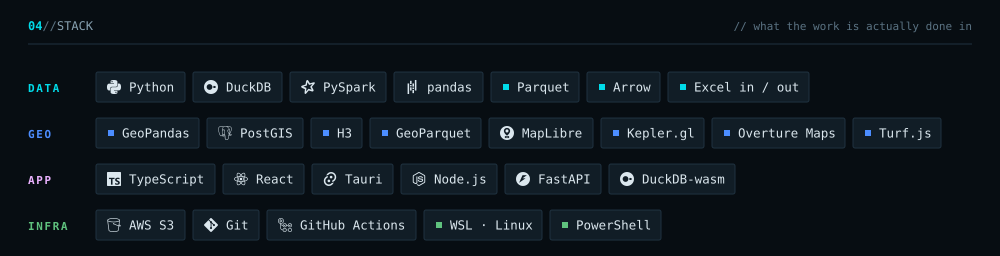

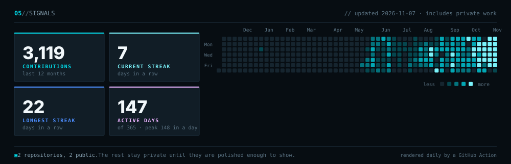

<p>
  <a href="https://github.com/Kenzy-Zero">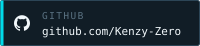</a>
  <a href="https://www.linkedin.com/in/kenzy-zero/">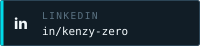</a>
  <a href="https://x.com/kenzy_zero">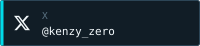</a>
  <a href="https://www.reddit.com/user/kenzy_zero/">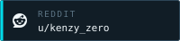</a>
  <a href="https://dev.to/kenzyzero">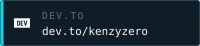</a>
  <a href="mailto:kenzy.zero.k0@gmail.com">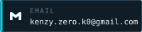</a>
  <a href="https://pypi.org/project/kenze/">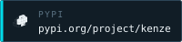</a>
</p>

